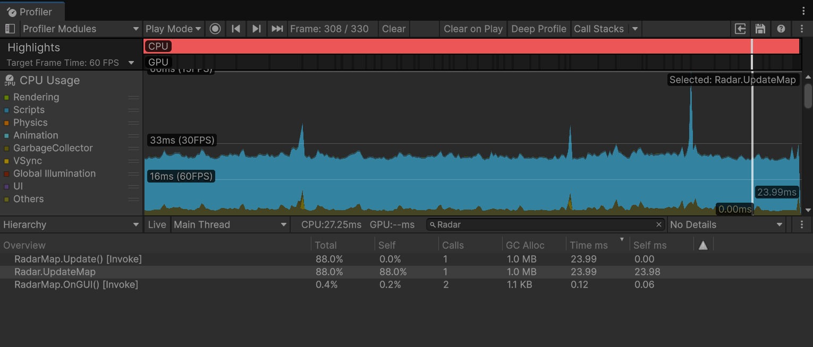
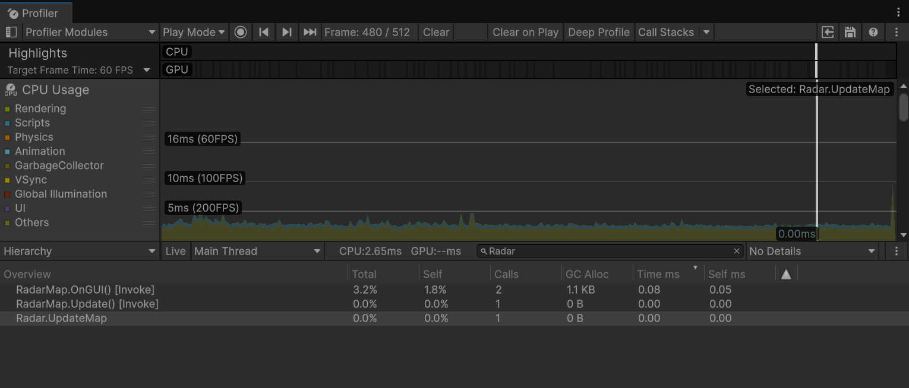

# Coastal Radar

I built a radar with a moving sweep over a fixed terrain map. In Unity Play Mode, the CPU Profiler showed that rebuilding the 512 × 512 map took **23.99 ms** and allocated **1.0 MB** in the selected frame. I generated the map once and reused it as the sweep moved. The same update then took **under 0.01 ms** and allocated **0 B**.

**Before · Rebuild every frame**

**After · Reuse the cached map**

